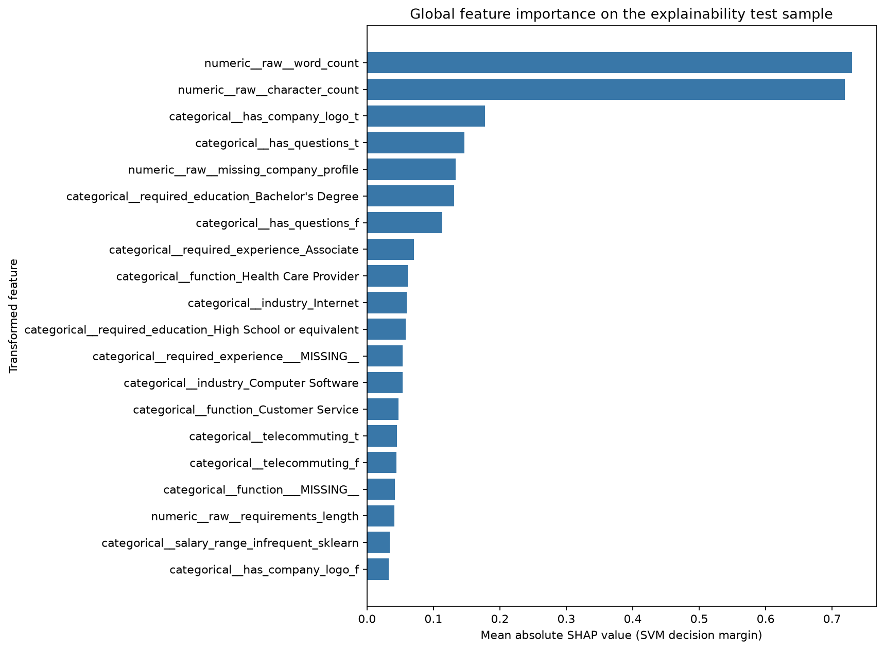

# Model Explainability Report

## Scope and method

- Saved app model: calibrated `LinearSVC` ensemble; no fitting or threshold tuning was performed in this notebook.
- Held-out test rows: 3,529; SHAP-explained rows: 162; sampled training background rows: 40.
- Prediction threshold: 0.40 from `models/model_threshold.json`.
- Raw and processed rows, target labels, and cleaned text were checked for row-by-row alignment before the original stratified 80/20 split was reproduced.
- SHAP values are averaged across the three fitted Linear SVM components and describe the underlying decision margin, not calibrated probability points.

## Simple interpretation

A positive SHAP contribution moves the model's SVM margin toward predicting fraud; a negative contribution moves it away. A larger absolute value means a stronger contribution relative to the sampled background. The calibrated probability combines component margins through sigmoid calibration, so an individual margin contribution is not a fixed percentage-point change in risk. These associations explain model behavior, not cause or proof: one feature cannot establish that a job posting is fraudulent or legitimate.

The saved base estimator is Linear SVM; SHAP margin contributions are used instead of Logistic Regression coefficients or tree feature importance.

## Global feature importance

Top 20 features by mean absolute SHAP value on the test sample:
- `numeric__raw__word_count`: mean |SHAP| = 0.72971; mean signed SHAP = +0.08895
- `numeric__raw__character_count`: mean |SHAP| = 0.71897; mean signed SHAP = -0.08127
- `categorical__has_company_logo_t`: mean |SHAP| = 0.17780; mean signed SHAP = -0.01794
- `categorical__has_questions_t`: mean |SHAP| = 0.14663; mean signed SHAP = +0.02022
- `numeric__raw__missing_company_profile`: mean |SHAP| = 0.13337; mean signed SHAP = -0.02216
- `categorical__required_education_Bachelor's Degree`: mean |SHAP| = 0.13114; mean signed SHAP = +0.00878
- `categorical__has_questions_f`: mean |SHAP| = 0.11323; mean signed SHAP = -0.01562
- `categorical__required_experience_Associate`: mean |SHAP| = 0.07103; mean signed SHAP = +0.00257
- `categorical__function_Health Care Provider`: mean |SHAP| = 0.06100; mean signed SHAP = +0.02138
- `categorical__industry_Internet`: mean |SHAP| = 0.05990; mean signed SHAP = +0.01312
- `categorical__required_education_High School or equivalent`: mean |SHAP| = 0.05841; mean signed SHAP = -0.00172
- `categorical__required_experience___MISSING__`: mean |SHAP| = 0.05376; mean signed SHAP = -0.00051
- `categorical__industry_Computer Software`: mean |SHAP| = 0.05324; mean signed SHAP = -0.01317
- `categorical__function_Customer Service`: mean |SHAP| = 0.04722; mean signed SHAP = -0.00379
- `categorical__telecommuting_t`: mean |SHAP| = 0.04538; mean signed SHAP = +0.03150
- `categorical__telecommuting_f`: mean |SHAP| = 0.04398; mean signed SHAP = -0.03053
- `categorical__function___MISSING__`: mean |SHAP| = 0.04173; mean signed SHAP = +0.00021
- `numeric__raw__requirements_length`: mean |SHAP| = 0.04110; mean signed SHAP = +0.00413
- `categorical__salary_range_infrequent_sklearn`: mean |SHAP| = 0.03418; mean signed SHAP = -0.01053
- `categorical__has_company_logo_f`: mean |SHAP| = 0.03241; mean signed SHAP = +0.00327

### Scam-indicator features

Ranked by mean absolute SHAP contribution; the signed mean indicates the average direction in SVM-margin units:
- `numeric__raw__contains_work_from_home`: mean |SHAP| = 0.01173; mean signed SHAP = -0.00411
- `numeric__raw__contains_urgent_language`: mean |SHAP| = 0.00220; mean signed SHAP = +0.00001
- `numeric__raw__contains_no_experience`: mean |SHAP| = 0.00210; mean signed SHAP = +0.00210
- `numeric__raw__contains_whatsapp_or_telegram`: mean |SHAP| = 0.00000; mean signed SHAP = +0.00000
- `numeric__raw__contains_cryptocurrency_payment`: mean |SHAP| = 0.00000; mean signed SHAP = +0.00000
- `numeric__raw__contains_easy_money`: mean |SHAP| = 0.00000; mean signed SHAP = +0.00000
- `numeric__raw__contains_fee_request`: mean |SHAP| = 0.00000; mean signed SHAP = +0.00000

## Local explanations

Examples were selected from test predictions made using the saved threshold. Positive and negative contributions refer to the average SVM decision margin, not calibrated percentage points. Titles and short description excerpts are included to identify each example; interpret them carefully because feature associations are not proof.

### Correctly detected fraudulent

#### Example 1: Cruise Staff Wanted *URGENT*
- Actual: fraud; predicted: fraud; calibrated fraud risk: 97.5%.
- Posting description preview: 
<b>6* Ultra Luxury American Cruise Company is urgently looking for the following positions:</b> <b>*Hospitality</b> - For the many Bars &amp; Restaurants on board. <b>*Retail</b> - For the Duty FREE Shops &amp; Boutiques on board. <b>*housekeeping</b> - For the Housekeeping &amp; Cleaning jobs. <b>*Offic
- Contributions moving the SVM margin toward fraud: numeric__raw__word_count (+0.4691); categorical__industry_Leisure, Travel & Tourism (+0.4624); categorical__has_company_logo_t (+0.3083); numeric__raw__missing_company_profile (+0.2371); categorical__has_questions_t (+0.1689).
- Contributions moving the SVM margin away from fraud: numeric__raw__character_count (-0.4468); categorical__has_questions_f (-0.1305); categorical__has_company_logo_f (-0.0562); text__english (-0.0489); categorical__telecommuting_f (-0.0384).

#### Example 2: Director of Engineering
- Actual: fraud; predicted: fraud; calibrated fraud risk: 99.2%.
- Posting description preview: 
Reporting to the VP of Service Provider Engineering, the Director of Engineering will have responsibility for managing the successful development and deployment of the company’s Security products and solutions.
 
The individual will manage a focused team of engineers in addition to leading and directing numerou
- Contributions moving the SVM margin toward fraud: numeric__raw__character_count (+1.8101); categorical__location_US, CA, San Jose (+0.5599); categorical__department_Engineering (+0.4025); categorical__industry_Computer Networking (+0.3632); numeric__raw__url_count (+0.1549).
- Contributions moving the SVM margin away from fraud: numeric__raw__word_count (-1.6921); categorical__required_education_Master's Degree (-0.1636); categorical__has_company_logo_t (-0.1321); categorical__has_questions_t (-0.1249); categorical__required_experience_Director (-0.1098).

#### Example 3: RECEPTIONIST / DATA ENTRY / OFFICE CLERK
- Actual: fraud; predicted: fraud; calibrated fraud risk: 95.6%.
- Posting description preview: 
is seeking to hire a full time Data Entry/Clerical/Receptionist. This position is responsible for general clerical duties, data entry and answering an 8-multi-line telephone system.
 
Knowledge of the Plumbing/Mechanical/HVAC industry is a plus.
 
JOB FUNCTIONS:
 
Entering Orders and Invoicing Must
- Contributions moving the SVM margin toward fraud: numeric__raw__word_count (+1.0767); categorical__industry_Accounting (+0.5659); categorical__has_company_logo_t (+0.3083); categorical__function_Administrative (+0.2783); numeric__raw__missing_company_profile (+0.2371).
- Contributions moving the SVM margin away from fraud: numeric__raw__character_count (-1.0746); categorical__has_questions_f (-0.1305); text__00 (-0.0729); text__50 (-0.0605); categorical__has_company_logo_f (-0.0562).

### Correctly detected legitimate

#### Example 1: Manufacturing Technician: Selective Laser Sintering (SLS)
- Actual: legitimate; predicted: legitimate; calibrated fraud risk: 0.0%.
- Posting description preview: 
Are you excited about what 3D printing could mean for manufacturing, and the future of personal production? We're looking for a sharp, innovative do-er--with direct experience in a manufacturing environment--to delve into the cutting edge of 3D printing and help create solutions to problems that have yet to be solve
- Contributions moving the SVM margin toward fraud: numeric__raw__character_count (+1.2349); categorical__has_questions_t (+0.1689); categorical__required_education_Bachelor's Degree (+0.0994); categorical__function_Health Care Provider (+0.0422); categorical__telecommuting_t (+0.0397).
- Contributions moving the SVM margin away from fraud: numeric__raw__word_count (-1.3493); categorical__required_experience_Associate (-0.2919); categorical__function_Manufacturing (-0.2565); categorical__has_company_logo_t (-0.1321); categorical__has_questions_f (-0.1305).

#### Example 2: Production Manager
- Actual: legitimate; predicted: legitimate; calibrated fraud risk: 0.0%.
- Posting description preview: 
<i>Reporting to the VPs of Development &amp; Production</i>
 
The Production Manager will facilitate and direct seasonal workflow for all Proenza Schouler production. He/She will strategize with the VP of Production to ensure that supply chain partners are continuously improving efficiencies and speed to market
- Contributions moving the SVM margin toward fraud: numeric__raw__word_count (+0.8597); categorical__location___MISSING__ (+0.3511); numeric__raw__missing_company_profile (+0.2371); text__he (+0.1215); categorical__has_questions_f (+0.0964).
- Contributions moving the SVM margin away from fraud: numeric__raw__character_count (-0.8167); categorical__function_Production (-0.6173); categorical__required_education_Bachelor's Degree (-0.2065); categorical__has_company_logo_t (-0.1321); categorical__has_questions_t (-0.1249).

#### Example 3: ACTIONSCRIPT DEVELOPER
- Actual: legitimate; predicted: legitimate; calibrated fraud risk: 0.2%.
- Posting description preview: 
Our client is a Swedish game studio developing innovative video slots for the free to play social and the online gambling market. Their team has years of experience, a burning passion for gaming and a love for gambling, but most importantly, they care about and respect their players.
 
<b>About the role</b>

- Contributions moving the SVM margin toward fraud: categorical__has_company_logo_t (+0.3083); numeric__raw__missing_company_profile (+0.2371); numeric__raw__word_count (+0.2001); categorical__required_education_Bachelor's Degree (+0.0994); categorical__has_questions_f (+0.0964).
- Contributions moving the SVM margin away from fraud: categorical__department_IT (-0.2969); numeric__raw__character_count (-0.2932); categorical__has_questions_t (-0.1249); text__client (-0.0703); numeric__raw__requirements_length (-0.0616).

### False positives

#### Example 1: Payroll  Clerk $20/hr
- Actual: legitimate; predicted: fraud; calibrated fraud risk: 72.4%.
- Posting description preview: 
The Accounting clerk will work in a team environment providing general clerical, accounting and office support. Primary duties will include but are not limited to: data entry (both numerical and alphabetical) , filing, bank statement reconciliation. Generating client's monthly financial statements. Handling Rebates 
- Contributions moving the SVM margin toward fraud: numeric__raw__word_count (+0.7599); categorical__function_Accounting/Auditing (+0.3118); categorical__has_company_logo_t (+0.3083); numeric__raw__missing_company_profile (+0.2371); categorical__required_education_High School or equivalent (+0.1701).
- Contributions moving the SVM margin away from fraud: numeric__raw__character_count (-0.7866); categorical__has_questions_f (-0.1305); text__handling (-0.0628); text__00 (-0.0577); categorical__has_company_logo_f (-0.0562).

#### Example 2: Tax Clerk
- Actual: legitimate; predicted: fraud; calibrated fraud risk: 70.2%.
- Posting description preview: 
<b>Job Description:</b>
 
The Tax Clerk will perform general accounting duties as well as office duties for the Tax Department.
 <ul> <li>Ability to Deal with extremely confidential material.</li> <li>Perform General Ledger Duties.</li> <li>Bookkeeping duties on several smaller entities within the company.</
- Contributions moving the SVM margin toward fraud: numeric__raw__character_count (+1.1402); categorical__location_US, TX, Houston (+0.5691); categorical__industry_Oil & Energy (+0.5268); categorical__function_Accounting/Auditing (+0.3118); categorical__has_questions_t (+0.1689).
- Contributions moving the SVM margin away from fraud: numeric__raw__word_count (-1.1800); categorical__has_company_logo_t (-0.1321); categorical__has_questions_f (-0.1305); numeric__raw__missing_company_profile (-0.1016); categorical__required_education_Associate Degree (-0.0946).

#### Example 3: Part Time Ground representative
- Actual: legitimate; predicted: fraud; calibrated fraud risk: 77.6%.
- Posting description preview: 
Work for a world leading NGO- Non Governmental Organisation
 
As a ground representative. No previous experience required.
 
Earn good without affecting your current schedule.

- Contributions moving the SVM margin toward fraud: numeric__raw__word_count (+1.4803); numeric__raw__contains_no_experience (+0.3404); categorical__has_company_logo_t (+0.3083); numeric__raw__missing_company_profile (+0.2371); text__earn (+0.1743).
- Contributions moving the SVM margin away from fraud: numeric__raw__character_count (-1.4489); categorical__has_questions_f (-0.1305); text__organisation (-0.0637); text__non (-0.0593); categorical__has_company_logo_f (-0.0562).

### False negatives

#### Example 1: Data Center Migration App Lead for FULL-TIME Opportunity.
- Actual: fraud; predicted: legitimate; calibrated fraud risk: 0.8%.
- Posting description preview: 
Data Center Migration Application Lead / Architect – must have prior <b>large data center</b> and <b>applications migrations experience</b>
 
<b>10-15 Years</b> of Experience / <b>10+Years</b> of experience in infrastructure /data center /application migration
 
Knowledgeable of Tools required (e.g. <b>Pla
- Contributions moving the SVM margin toward fraud: numeric__raw__word_count (+1.2546); categorical__has_company_logo_t (+0.3083); numeric__raw__missing_company_profile (+0.2371); text__migration (+0.1792); categorical__has_questions_t (+0.1689).
- Contributions moving the SVM margin away from fraud: numeric__raw__character_count (-1.1936); categorical__salary_range_0-0 (-0.3883); categorical__required_education_Bachelor's Degree (-0.2065); categorical__has_questions_f (-0.1305); categorical__required_experience_Director (-0.1098).

#### Example 2:  Data Entry Representative
- Actual: fraud; predicted: legitimate; calibrated fraud risk: 15.5%.
- Posting description preview: <ul> <li>Responsible for reviewing details of tickets to ensure they contain the data required by customers.</li> <li>Monitors the bin movements to ensure the activity seen matches the paperwork provided</li> <li>Watches contract levels vs volume remaining in bins and reports any discrepancy to quality manager</li> <li
- Contributions moving the SVM margin toward fraud: categorical__function_Customer Service (+0.2513); categorical__required_education_High School or equivalent (+0.1701); numeric__raw__word_count (+0.1350); categorical__required_education_Bachelor's Degree (+0.0994); categorical__has_questions_f (+0.0964).
- Contributions moving the SVM margin away from fraud: categorical__required_experience_Associate (-0.2919); categorical__has_company_logo_t (-0.1321); categorical__has_questions_t (-0.1249); numeric__raw__missing_company_profile (-0.1016); numeric__raw__character_count (-0.0949).

#### Example 3: Administrative Position 
- Actual: fraud; predicted: legitimate; calibrated fraud risk: 28.9%.
- Posting description preview: 
International private equity looking for an administrative assistant to be part of a great team! This executive assistant must have experience with heavy calendar management and travel experience. The ideal candidate should have between 2-4 years experience as an executive assistant and have worked with c-level exec
- Contributions moving the SVM margin toward fraud: numeric__raw__word_count (+0.9205); categorical__has_company_logo_t (+0.3083); categorical__function_Administrative (+0.2783); numeric__raw__missing_company_profile (+0.2371); categorical__telecommuting_f (+0.2178).
- Contributions moving the SVM margin away from fraud: numeric__raw__character_count (-0.9133); categorical__telecommuting_t (-0.2248); categorical__has_questions_f (-0.1305); text__candidate should (-0.0636); categorical__has_company_logo_f (-0.0562).

## Limitations

The global rankings depend on this model, dataset, and sampled background/test postings. Correlated words or features can share attribution, and transformed one-hot/text features may be less intuitive than the original posting. SHAP describes how this fitted model uses its inputs; it does not establish causation, fairness, generalization, or the truth of a fraud claim.
